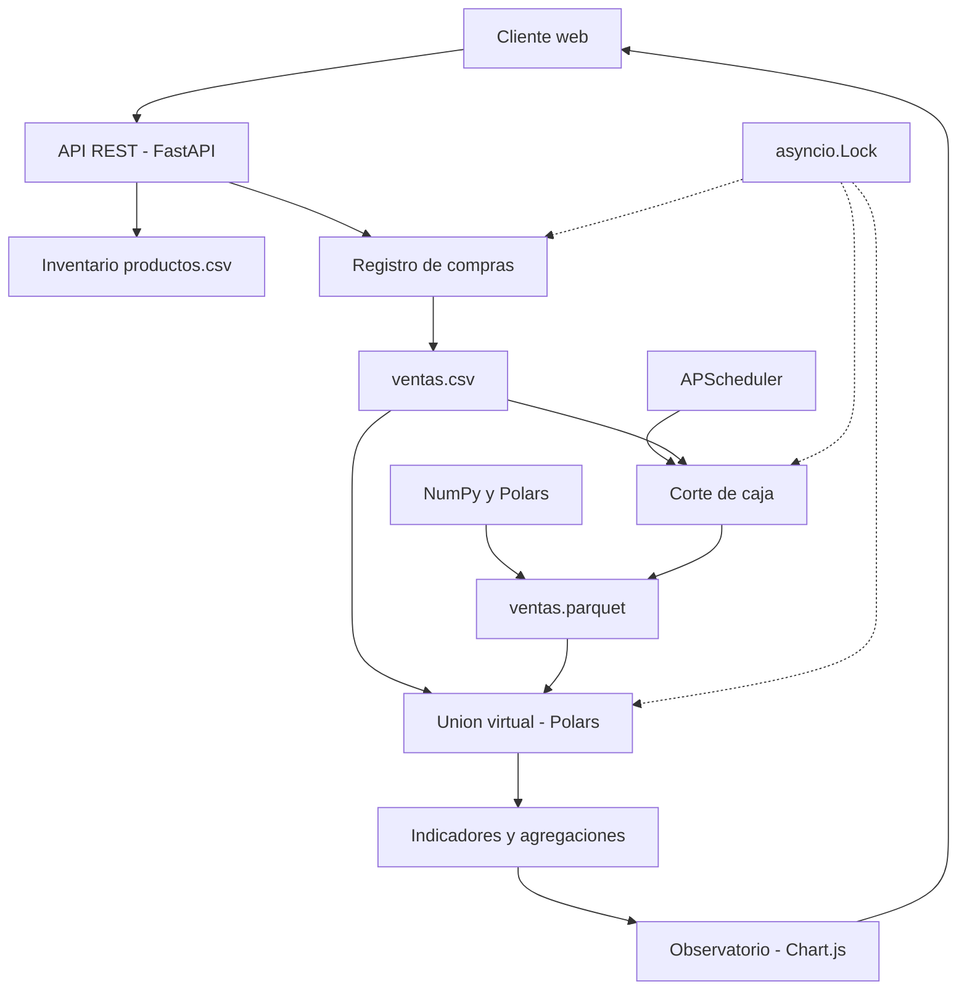

# ERIDANUS — Gabinete de Curiosidades

## Proyecto 4: Tienda Full-Stack con Procesamiento Masivo de Datos, Polars, Parquet y Automatización

**Versión 4.0 | Programación IV**

Proyecto académico de desarrollo de aplicaciones, servicios REST, persistencia de datos, análisis de información y automatización de procesos.

---

## 1. Descripción

ERIDANUS es una tienda virtual de artículos científicos, históricos y educativos, inspirada en los antiguos gabinetes de curiosidades.

Su catálogo está integrado por 20 productos distribuidos en seis categorías:

- Astronomía.
- Paleontología.
- Geografía y exploración.
- Arqueología e historia.
- Ciencias naturales.
- Coleccionables.

El sistema integra una API REST desarrollada con FastAPI, una interfaz web interactiva, persistencia de inventario mediante CSV, procesamiento masivo de ventas con Polars, almacenamiento histórico en Parquet y automatización del corte de caja mediante APScheduler.

El Observatorio de ERIDANUS permite consultar indicadores comerciales y visualizar el comportamiento de las ventas mediante Chart.js.

---

## 2. Evolución del proyecto

| Proyecto | Etapa de desarrollo |
|---|---|
| Proyecto 1 | Desarrollo de la API REST y operaciones de inventario. |
| Proyecto 2 | Integración del cliente web y comunicación con el backend. |
| Proyecto 3 | Persistencia CSV, análisis con Pandas y dashboard interactivo. |
| Proyecto 4 | Procesamiento masivo con Polars, Parquet, concurrencia y automatización. |

La versión 4.0 conserva las funcionalidades comerciales de las etapas anteriores y sustituye el motor analítico basado en Pandas por una arquitectura híbrida de almacenamiento y procesamiento con Polars.

---

## 3. Tecnologías utilizadas

| Tecnología | Aplicación |
|---|---|
| Python | Lenguaje de programación del backend. |
| FastAPI | Desarrollo de la API REST. |
| Uvicorn | Servidor ASGI. |
| Pandas | Motor analítico utilizado en la etapa anterior. |
| NumPy | Generación masiva de ventas simuladas. |
| Polars | Procesamiento analítico de datos. |
| Apache Parquet | Almacenamiento histórico columnar. |
| Zstandard | Compresión del archivo Parquet. |
| CSV | Persistencia del inventario y ventas recientes. |
| asyncio | Coordinación de operaciones concurrentes. |
| APScheduler | Automatización del corte de caja. |
| HTML5 | Estructura de la interfaz. |
| CSS3 | Diseño y personalización visual. |
| JavaScript | Interacción con el usuario. |
| Fetch API | Comunicación entre frontend y backend. |
| Chart.js | Visualización de indicadores comerciales. |
| Requests | Pruebas HTTP de concurrencia. |
| Locust | Pruebas de carga. |

---

## 4. Arquitectura del sistema



La arquitectura separa las operaciones comerciales del almacenamiento histórico.

Las compras se registran inicialmente en un archivo CSV ligero. El histórico se conserva en formato Parquet y ambos conjuntos de datos se integran mediante consultas de Polars.

El corte de caja consolida periódicamente las ventas recientes en el histórico.

---

## 5. Funcionalidades

### 5.1. Catálogo de productos

- Consulta de productos desde la API.
- Visualización de nombres, categorías, descripciones, precios e imágenes.
- Búsqueda de artículos por nombre.
- Filtrado por categorías.
- Consulta de existencias.
- Compra de productos desde la interfaz.

### 5.2. Administración del inventario

- Registro de nuevos productos.
- Consulta y eliminación de productos.
- Validación de nombres duplicados.
- Actualización automática de existencias.
- Prevención de ventas superiores al stock disponible.
- Persistencia mediante productos.csv.

### 5.3. Registro de ventas

Cada compra genera una transacción con un identificador único.

Las nuevas ventas se almacenan en ventas.csv sin reescribir el archivo histórico Parquet.

### 5.4. Observatorio de ERIDANUS

El dashboard presenta:

- Ingresos acumulados.
- Número de transacciones.
- Unidades vendidas.
- Ticket promedio.
- Producto más vendido.
- Gráfica de barras de ingresos por producto.
- Gráfica de dona de ingresos por categoría.

Los indicadores se actualizan después de realizar compras y consideran tanto las ventas históricas como las recientes.

---

## 6. Generación masiva de datos

El script generar_parquet.py genera 2,000,000 de transacciones simuladas utilizando NumPy y Polars.

Características:

- Selección de productos a partir del catálogo.
- Generación de cantidades y fechas simuladas.
- Cálculo de importes por transacción.
- Identificadores consecutivos.
- Semilla aleatoria para reproducibilidad.
- Almacenamiento en formato Parquet.
- Compresión Zstandard.
- Protección contra sobrescritura accidental del histórico.

### Resultados de la generación inicial

| Indicador | Resultado |
|---|---:|
| Transacciones simuladas | 2,000,000 |
| Columnas | 6 |
| Tamaño del archivo | 21.63 MiB |
| Tiempo observado de generación | 0.49 segundos |

Los tiempos corresponden al entorno de desarrollo utilizado y pueden variar según el equipo.

Las ventas históricas son simuladas y no representan transacciones comerciales reales.

---

## 7. Esquema de datos

Los archivos ventas.csv y ventas.parquet utilizan un esquema común.

| Campo | Tipo en Polars | Descripción |
|---|---|---|
| id_venta | Int64 | Identificador único de la transacción. |
| fecha | Datetime | Fecha y hora de la venta. |
| producto | String | Nombre del producto. |
| precio | Float64 | Precio unitario. |
| cantidad | Int64 | Unidades vendidas. |
| monto_total | Float64 | Importe total de la transacción. |

El esquema se centraliza en esquema_ventas.py.

---

## 8. Procesamiento analítico con Polars

La versión 4.0 utiliza:

- pl.scan_parquet() para consultar el histórico.
- pl.scan_csv() para consultar ventas recientes.
- LazyFrame para construir consultas diferidas.
- pl.concat() para integrar ambos conjuntos de datos.
- Anti join para excluir ventas recientes previamente consolidadas.
- group_by() para realizar agregaciones.
- collect() para ejecutar las consultas.
- to_dicts() para generar estructuras compatibles con JSON.

La unión virtual permite consultar el histórico y las ventas recientes sin crear un nuevo archivo Parquet después de cada compra.

Los endpoints anteriores se conservan para mantener la compatibilidad con el frontend.

---

## 9. Concurrencia y consistencia

El módulo concurrencia.py centraliza un mecanismo de exclusión mutua mediante asyncio.Lock.

Este bloqueo es compartido por:

- Registro de compras.
- Administración del inventario.
- Consultas analíticas.
- Corte de caja.

Su finalidad es impedir modificaciones simultáneas incompatibles sobre los archivos y proteger la consistencia del inventario y las transacciones.

Las pruebas realizadas demostraron que el sistema puede procesar solicitudes concurrentes sin generar identificadores duplicados ni permitir existencias negativas.

---

## 10. Corte de caja automático

El módulo corte_caja.py consolida las ventas recientes en el histórico Parquet.

El procedimiento comprende:

1. Adquirir el bloqueo compartido.
2. Leer las ventas recientes.
3. Leer el histórico.
4. Validar identificadores.
5. Detectar registros previamente consolidados.
6. Comprobar posibles conflictos.
7. Integrar únicamente las ventas pendientes.
8. Escribir un archivo Parquet temporal.
9. Reemplazar el histórico.
10. Vaciar el CSV conservando sus encabezados.
11. Liberar el bloqueo.

APScheduler se integra con el ciclo de vida de FastAPI.

### Modalidades de ejecución

| Modalidad | Frecuencia |
|---|---|
| demo | Cada dos minutos. |
| produccion | Diariamente a las 00:00 horas. |

Zona horaria: America/Mexico_City.

El sistema utiliza el modo demo de manera predeterminada.

### Recuperación e idempotencia

Si una interrupción ocurre después de actualizar el Parquet, pero antes de vaciar el CSV, las ventas previamente consolidadas se identifican mediante su ID.

La repetición del corte no duplica dichas transacciones.

Si se detectan registros con el mismo identificador, pero información contradictoria, la consolidación se interrumpe y se conservan ambos archivos.

---

## 11. Estructura del proyecto

```text
ERIDANUS/
├── main.py
├── analitica.py
├── concurrencia.py
├── corte_caja.py
├── esquema_ventas.py
├── generar_parquet.py
├── migrar_ventas.py
├── productos.csv
├── ventas.csv
├── fuentes_productos.csv
├── index.html
├── app.js
├── styles.css
├── locustfile.py
├── prueba_concurrencia.py
├── prueba_recuperacion.py
├── prueba_compra_corte.py
├── requirements.txt
├── README.md
├── .gitignore
└── img/
```

El archivo ventas.parquet se genera localmente y no se incluye en el repositorio.

La carpeta img/ contiene las 20 imágenes del catálogo comercial.

---

## 12. Instalación y ejecución

### Paso 1. Clonar el repositorio

```bash
git clone https://github.com/victormendoza2539-prog/ERIDANUS.git
cd ERIDANUS
git switch proyecto-4
```

### Paso 2. Instalar las dependencias

```bash
python -m pip install -r requirements.txt
```

### Paso 3. Generar el histórico de ventas

```bash
python generar_parquet.py
```

Este procedimiento crea ventas.parquet con 2,000,000 de registros simulados.

El archivo ventas.csv incluido en el repositorio contiene únicamente los encabezados necesarios para registrar nuevas transacciones.

### Paso 4. Iniciar FastAPI

```bash
python -m uvicorn main:app --workers 1
```

API REST:

http://127.0.0.1:8000

Documentación interactiva Swagger:

http://127.0.0.1:8000/docs

### Paso 5. Ejecutar la tienda

Abrir index.html mediante la extensión Live Server de Visual Studio Code.

Alternativamente, iniciar un servidor web estático desde otra terminal:

```bash
python -m http.server 5500
```

Acceder a:

http://127.0.0.1:5500

Mantener FastAPI en ejecución mientras se utiliza la interfaz.

### Configurar el corte de caja en PowerShell

Modo demostración:

```powershell
$env:MODO_CORTE="demo"
python -m uvicorn main:app --workers 1
```

Modo de producción:

```powershell
$env:MODO_CORTE="produccion"
python -m uvicorn main:app --workers 1
```

### Migración desde el Proyecto 3

El script migrar_ventas.py permite convertir las ventas del esquema anterior al esquema de la versión 4.0.

Debe utilizarse únicamente cuando se dispone de un archivo CSV con el formato anterior y después de generar el histórico Parquet.

No es necesario ejecutarlo en una instalación nueva.

---

## 13. Endpoints principales

| Método | Endpoint | Descripción |
|---|---|---|
| GET | / | Bienvenida a la API. |
| GET | /productos | Consultar catálogo. |
| GET | /productos/{producto_id} | Consultar producto. |
| POST | /productos | Registrar producto. |
| POST | /productos/{producto_id} | Comprar producto. |
| DELETE | /productos/{producto_id} | Eliminar producto. |
| GET | /analitica/resumen | Consultar indicadores. |
| GET | /analitica/por-producto | Analizar ventas por producto. |
| GET | /analitica/por-categoria | Analizar ventas por categoría. |
| GET | /api/analisis/kpis | Consultar indicadores mediante Polars. |
| GET | /api/analisis/mas-vendidos | Consultar productos más vendidos. |

---

## 14. Persistencia de datos

| Archivo | Función |
|---|---|
| productos.csv | Inventario y catálogo comercial. |
| ventas.csv | Transacciones recientes pendientes de consolidación. |
| ventas.parquet | Histórico de ventas comprimido. |
| fuentes_productos.csv | Documentación de referencias comerciales. |

Los archivos Parquet, respaldos y archivos temporales se excluyen del control de versiones mediante .gitignore.

El histórico puede reproducirse localmente mediante generar_parquet.py.

---

## 15. Pruebas y validación experimental

### 15.1. Pruebas de compras concurrentes

| Indicador | Prueba A | Prueba B |
|---|---:|---:|
| Stock inicial | 20 | 10 |
| Solicitudes concurrentes | 10 | 20 |
| Compras exitosas | 10 | 10 |
| Compras rechazadas | 0 | 10 |
| IDs duplicados | 0 | 0 |
| Stock final | 10 | 0 |
| Tiempo observado | 0.435 s | 1.030 s |

Resultado: prevención de sobreventa y ausencia de identificadores duplicados en las pruebas realizadas.

### 15.2. Corte de caja automático

| Indicador | Resultado |
|---|---:|
| Histórico inicial | 2,000,000 |
| Ventas consolidadas | 5 |
| Histórico posterior | 2,000,005 |
| Ventas pendientes | 0 |
| Tiempo observado | 0.325 s |

Se verificó que los indicadores permanecieron consistentes antes y después de la consolidación.

También se comprobó mediante SHA-256 que las compras ordinarias no modificaban el archivo Parquet antes del corte.

### 15.3. Pruebas de recuperación

| Escenario | Resultado |
|---|---|
| D1. Unión virtual sin duplicados | Superada |
| D2. Recuperación de corte interrumpido | Superada |
| D3. Detección de registros contradictorios | Superada |

Las pruebas se realizaron mediante archivos temporales independientes del histórico real.

### 15.4. Concurrencia entre compras y corte de caja

| Indicador | Resultado |
|---|---:|
| Compras concurrentes exitosas | 5 |
| Ventas finales en Parquet | 3 |
| Ventas finales en CSV | 5 |
| Transacciones totales | 8 |
| Identificadores únicos | 8 |
| Stock final | 5 |
| Ingresos experimentales | $800.00 |

Se obtuvieron los resultados esperados al ejecutar las funciones reales de compra y consolidación bajo condiciones controladas.

### 15.5. Estado del histórico al finalizar las pruebas

| Indicador | Resultado |
|---|---:|
| Transacciones | 2,000,026 |
| Unidades vendidas | 6,002,498 |
| Ingresos acumulados | $5,297,946,370.00 |
| Ticket promedio | $2,648.94 |
| IDs únicos | 2,000,026 |

Producto más vendido: Maqueta de México-Tenochtitlan.

Unidades vendidas del producto líder: 301,490.

Estos valores corresponden al histórico local utilizado durante el desarrollo, incluyendo las ventas experimentales.

Una instalación nueva comienza con 2,000,000 de transacciones simuladas.

---

## 16. Reproducción de las pruebas

### Pruebas de recuperación

Con Uvicorn detenido:

```bash
python prueba_recuperacion.py
```

### Prueba de concurrencia entre compras y corte

Con Uvicorn detenido:

```bash
python prueba_compra_corte.py
```

Ambas pruebas utilizan archivos temporales y no modifican el histórico principal.

### Pruebas HTTP de concurrencia

Con Uvicorn en ejecución:

```bash
python prueba_concurrencia.py
```

El script crea un producto experimental, ejecuta dos escenarios de concurrencia y elimina el producto al finalizar.

Las ventas experimentales permanecen registradas en el histórico utilizado. Se recomienda ejecutar esta prueba sobre una instalación destinada a experimentación.

La versión automatizada del script deriva de las pruebas A y B realizadas durante el desarrollo.

### Pruebas de carga con Locust

Con Uvicorn en ejecución:

```bash
python -m locust -f locustfile.py --host http://127.0.0.1:8000
```

Interfaz de Locust:

http://127.0.0.1:8089

Advertencia: el escenario de Locust incluye operaciones de compra y puede modificar el inventario y el historial de ventas.

---

## 17. Alcance y limitaciones

ERIDANUS 4.0 constituye un prototipo académico funcional.

Consideraciones:

- El servidor debe ejecutarse con un único worker de Uvicorn para compartir correctamente el bloqueo de asyncio.
- El sistema utiliza archivos CSV y Parquet, no una base de datos transaccional.
- No proporciona garantías ACID completas entre inventario y ventas.
- El corte automático requiere que el servidor permanezca en ejecución.
- Las ventas simuladas no representan movimientos reales del inventario.
- Las categorías históricas se obtienen del catálogo vigente.
- Los productos eliminados pueden aparecer como ventas sin categoría.
- Los tiempos de ejecución dependen del hardware y del entorno.
- No está diseñado para un despliegue comercial distribuido sin modificaciones adicionales.

---

## 18. Conclusiones

ERIDANUS 4.0 demuestra la integración de una aplicación comercial Full-Stack con herramientas de procesamiento masivo de datos.

La incorporación de Polars, NumPy y Parquet permite gestionar millones de transacciones mediante una arquitectura híbrida de almacenamiento.

La automatización del corte de caja y los mecanismos de exclusión mutua permiten coordinar las operaciones comerciales y analíticas.

Las pruebas experimentales realizadas respaldan la consistencia del inventario, la ausencia de duplicados en los escenarios evaluados y la capacidad de recuperación ante interrupciones simuladas.

El proyecto integra los conocimientos adquiridos durante las cuatro etapas de Programación IV.

---

## Autoría

Proyecto académico de Programación IV.

**ERIDANUS — Gabinete de Curiosidades**

Versión 4.0

Repositorio:

https://github.com/victormendoza2539-prog/ERIDANUS
